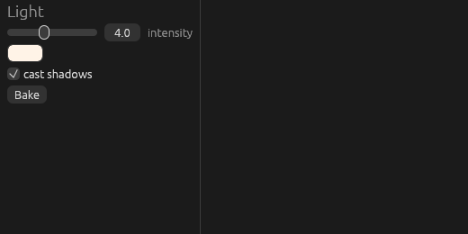
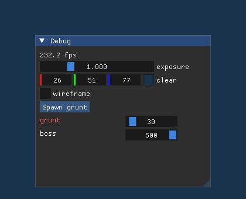
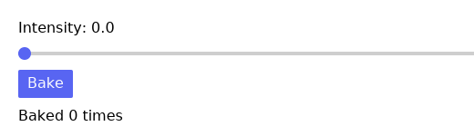
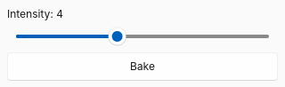

# User interfaces: tools, editors and game UI

A C++ engine typically has three kinds of UI: Dear ImGui for debug overlays
and quick tools, Qt or a custom framework for the editor, and a separate
system (custom, or middleware such as RmlUi or Noesis) for the in-game HUD and
menus. Rust has answers for all three, but the most common C++ design for
retained UI does not carry over directly, and understanding why makes the
Rust options easy to choose between.

This chapter covers:

- why callback-based widget trees fight the borrow checker,
- immediate mode with egui, as a standalone tool and as an overlay in your
  own renderer,
- Dear ImGui itself, through Rust bindings,
- message-based UI with iced, and declarative UI with Slint,
- in-game UI, and how to choose.

## Why UI is different in Rust

The classic retained-mode design stores callbacks in widgets, and the
callbacks capture a pointer to the state they change:

```cpp
// Qt-style C++
bakeButton->onClick([this] { light.intensity += 1.0f; label->setText(...); });
```

The lambda holds `this` for as long as the button exists, and mutates
`light` whenever a click arrives. Nothing stops two callbacks from changing
the same state, or a callback from running after `this` is destroyed. The
direct Rust translation does not compile, because a closure stored inside
`editor` cannot also hold a mutable borrow of `editor`:

```rust,compile_fail
struct Button { on_click: Box<dyn FnMut()> }
struct Editor { intensity: f32, bake: Button }

impl Editor {
    fn new() -> Editor {
        let mut editor = Editor { intensity: 1.0, bake: Button { on_click: Box::new(|| {}) } };
        editor.bake.on_click = Box::new(|| editor.intensity += 1.0); // error[E0506], error[E0597]
        editor
    }
}
# fn main() {}
```

You can make it work with shared ownership, `Rc<RefCell<State>>` captured by
every callback ([Smart pointers](../foundations/smart-pointers.md)), and
bindings to C and C++ toolkits (GTK, Qt) do exactly that. But it moves the
borrow checking to run time and spreads `borrow_mut()` across the UI. Rust UI
libraries instead pick one of three designs that avoid long-lived callbacks
holding mutable state:

| Design | Idea | Libraries |
|---|---|---|
| Immediate mode | No stored callbacks. UI code runs every frame with `&mut` access to your state and reacts to clicks on the spot | egui, Dear ImGui bindings |
| Messages (the Elm architecture) | Widgets produce messages. One `update` function owns all mutation; a `view` function builds the UI from the state | iced, Relm4 |
| Declarative with properties | The UI lives in its own language with reactive properties; Rust code connects callbacks through weak handles | Slint |

## egui: immediate mode

[egui](https://docs.rs/egui) is the Rust equivalent of Dear ImGui, written in
pure Rust. Your code describes the whole UI every frame, and each widget
returns whether it was interacted with. `eframe` wraps egui with a window and
a renderer for standalone tools:

```toml
[dependencies]
eframe = "0.37"
```

```rust,ignore
use eframe::egui;

struct LightTool {
    intensity: f32,
    color: [f32; 3],
    shadows: bool,
    log: Vec<String>,
}

impl eframe::App for LightTool {
    fn ui(&mut self, ui: &mut egui::Ui, _frame: &mut eframe::Frame) {
        egui::Panel::left("properties").show(ui, |ui| {
            ui.heading("Light");
            ui.add(egui::Slider::new(&mut self.intensity, 0.0..=10.0).text("intensity"));
            ui.color_edit_button_rgb(&mut self.color);
            ui.checkbox(&mut self.shadows, "cast shadows");
            if ui.button("Bake").clicked() {
                self.log.push(format!("baked at intensity {:.1}", self.intensity));
            }
        });
        egui::CentralPanel::default().show(ui, |ui| {
            for line in &self.log {
                ui.label(line);
            }
        });
    }
}

fn main() -> eframe::Result {
    let app = LightTool { intensity: 4.0, color: [1.0, 0.9, 0.8], shadows: true, log: Vec::new() };
    let options = eframe::NativeOptions {
        viewport: egui::ViewportBuilder::default().with_inner_size([520.0, 260.0]),
        ..Default::default()
    };
    eframe::run_native(
        "Light tool",
        options,
        Box::new(|_cc| Ok(Box::new(app))),
    )
}
```



`Slider::new(&mut self.intensity, ...)` borrows the field only for that call,
exactly like `ImGui::SliderFloat("intensity", &intensity, 0, 10)`. The click
is handled where the button is drawn, with full `&mut self` access, so there
is no callback to store and nothing to share. The costs are also the same as
Dear ImGui: layout is computed in one pass each frame, so some layouts need
workarounds, and the UI code runs every frame (eframe only repaints on input
by default, so an idle tool uses no CPU).

### egui inside your engine

For a debug overlay, you want egui drawn by your own renderer on top of the
game, with input shared between them. `egui-winit` translates winit events
into egui input, and `egui-wgpu` draws egui's triangles with wgpu (there are
also backends for glow, Vulkan through community crates, and others):

```toml
[dependencies]
egui = "0.37"
egui-winit = "0.37"
egui-wgpu = "0.37"
```

```rust,ignore
use egui_wgpu::wgpu;
use winit::window::Window;

/// An egui debug overlay drawn by your own renderer.
pub struct DebugUi {
    ctx: egui::Context,
    input: egui_winit::State,       // translates winit events into egui input
    renderer: egui_wgpu::Renderer,  // draws egui's triangles with wgpu
}

impl DebugUi {
    pub fn new(window: &Window, device: &wgpu::Device, format: wgpu::TextureFormat) -> Self {
        let ctx = egui::Context::default();
        let input = egui_winit::State::new(
            ctx.clone(), egui::ViewportId::ROOT, window,
            Some(window.scale_factor() as f32), None, None,
        );
        let renderer = egui_wgpu::Renderer::new(device, format, egui_wgpu::RendererOptions::default());
        DebugUi { ctx, input, renderer }
    }

    /// Call from `window_event`. Returns true if egui used the event
    /// (a click on a panel, typing in a text box): don't pass it to the game.
    pub fn on_event(&mut self, window: &Window, event: &winit::event::WindowEvent) -> bool {
        self.input.on_window_event(window, event).consumed
    }

    /// Call once per frame, after the game has rendered into `view`.
    pub fn draw(
        &mut self,
        window: &Window,
        device: &wgpu::Device,
        queue: &wgpu::Queue,
        encoder: &mut wgpu::CommandEncoder,
        view: &wgpu::TextureView,
        build: impl FnMut(&mut egui::Ui),
    ) {
        let raw_input = self.input.take_egui_input(window);
        let output = self.ctx.run_ui(raw_input, build);       // your UI code runs here
        self.input.handle_platform_output(window, output.platform_output); // cursor, clipboard

        let size = window.inner_size();
        let screen = egui_wgpu::ScreenDescriptor {
            size_in_pixels: [size.width, size.height],
            pixels_per_point: output.pixels_per_point,
        };
        let primitives = self.ctx.tessellate(output.shapes, output.pixels_per_point);
        for (id, deltas) in &output.textures_delta.set {
            for delta in deltas {
                self.renderer.update_texture(device, queue, *id, delta); // font atlas, images
            }
        }
        self.renderer.update_buffers(device, queue, encoder, &primitives, &screen);

        let pass = encoder.begin_render_pass(&wgpu::RenderPassDescriptor {
            label: Some("egui"),
            color_attachments: &[Some(wgpu::RenderPassColorAttachment {
                view,
                resolve_target: None,
                depth_slice: None,
                ops: wgpu::Operations { load: wgpu::LoadOp::Load, store: wgpu::StoreOp::Store }, // keep the game image
            })],
            ..Default::default()
        });
        self.renderer.render(&mut pass.forget_lifetime(), &primitives, &screen);
        for id in &output.textures_delta.free {
            self.renderer.free_texture(id);
        }
    }
}
```

```rust,ignore
// In the game's frame:
overlay.draw(&window, &device, &queue, &mut encoder, &view, |ui| {
    egui::Window::new("Debug").show(ui.ctx(), |ui| {
        ui.label(format!("{frame_ms:.1} ms"));
        ui.add(egui::Slider::new(&mut world.time_scale, 0.0..=4.0).text("time scale"));
        ui.checkbox(&mut renderer.wireframe, "wireframe");
    });
});
```

`on_event` reports whether egui consumed an event, so the game ignores
clicks and key presses that land on a debug window, which is the same check
as `io.WantCaptureMouse` in Dear ImGui. The closure passed to `draw` borrows
`world` and `renderer` mutably for the duration of the call, so tweaking
engine values from the overlay needs no globals.

## Dear ImGui

egui is a Rust redesign of the same idea, not a port. If your C++ tools are
already built on Dear ImGui, you can keep the library itself: your team keeps
the API it knows, and you keep docking, multi-viewport and the extensions
around it (ImPlot, ImGuizmo, node editors).

### Choosing a binding

| Crate | Notes |
|---|---|
| [dear-imgui-rs](https://docs.rs/dear-imgui-rs) | Actively maintained, tracks recent Dear ImGui releases on the docking branch. Platform backends for winit and SDL3, renderers for wgpu, OpenGL (glow) and Vulkan (ash), plus `dear-implot`, `dear-imguizmo`, `dear-imnodes` and more |
| [imgui](https://docs.rs/imgui) (imgui-rs) | The long-standing binding, with the most users and examples. Its last release was in 2024, so it lags behind Dear ImGui. Backends: `imgui-winit-support`, `imgui-wgpu`, `imgui-glow-renderer` |

Both have the same API shape, because dear-imgui-rs follows imgui-rs. The
examples here use dear-imgui-rs 0.23 with winit 0.30 and wgpu 30:

```toml
[dependencies]
dear-imgui-rs = "0.23"
dear-imgui-winit = "0.23"   # platform: input, cursor, DPI
dear-imgui-wgpu = "0.23"    # renderer
winit = "0.30"
wgpu = "30"
```

Unless a prebuilt library is available for your target, the bindings compile
Dear ImGui's C++ sources with the `cc` crate on the first build
([Assets, build scripts and serialization](assets-and-build.md)), so you need a C++ compiler
installed. egui has no such step.

### The same window in C++ and Rust

A debug window in C++:

```cpp
void DebugWindow(Game& game) {
    ImGui::SetNextWindowSize({300, 260}, ImGuiCond_FirstUseEver);
    if (ImGui::Begin("Debug")) {
        ImGui::Text("%.1f fps", ImGui::GetIO().Framerate);
        ImGui::SliderFloat("exposure", &game.exposure, 0.0f, 4.0f);
        ImGui::ColorEdit3("clear", game.clear);
        ImGui::Checkbox("wireframe", &game.wireframe);
        if (ImGui::Button("Spawn grunt"))
            game.enemies.push_back({"grunt", 30});
        if (ImGui::BeginTable("enemies", 2)) {
            for (int i = 0; i < (int)game.enemies.size(); ++i) {
                Enemy& enemy = game.enemies[i];
                ImGui::PushID(i);
                ImGui::TableNextRow();
                ImGui::TableNextColumn();
                bool low = enemy.hp < 50;
                if (low) ImGui::PushStyleColor(ImGuiCol_Text, IM_COL32(255, 100, 100, 255));
                ImGui::TextUnformatted(enemy.name);
                if (low) ImGui::PopStyleColor();
                ImGui::TableNextColumn();
                ImGui::SliderInt("##hp", &enemy.hp, 0, 500);
                ImGui::PopID();
            }
            ImGui::EndTable();
        }
    }
    ImGui::End();
}
```

And in Rust:

```rust,ignore
use dear_imgui_rs::{Condition, StyleColor, Ui};

struct Enemy {
    name: &'static str,
    hp: i32,
}

struct Game {
    clear: [f32; 3],
    exposure: f32,
    wireframe: bool,
    enemies: Vec<Enemy>,
}

fn debug_window(ui: &Ui, game: &mut Game) {
    ui.window("Debug")
        .size([300.0, 260.0], Condition::FirstUseEver)
        .build(|| {
            ui.text(format!("{:.1} fps", ui.io().framerate()));
            ui.slider("exposure", 0.0, 4.0, &mut game.exposure);
            ui.color_edit3("clear", &mut game.clear);
            ui.checkbox("wireframe", &mut game.wireframe);
            if ui.button("Spawn grunt") {
                game.enemies.push(Enemy { name: "grunt", hp: 30 });
            }
            if let Some(_table) = ui.begin_table("enemies", 2) {
                for (i, enemy) in game.enemies.iter_mut().enumerate() {
                    let _id = ui.push_id(i); // PushID(i) ... PopID() at the end of the loop body
                    ui.table_next_row();
                    ui.table_next_column();
                    let red = (enemy.hp < 50)
                        .then(|| ui.push_style_color(StyleColor::Text, [1.0, 0.4, 0.4, 1.0]));
                    ui.text(enemy.name);
                    drop(red); // PopStyleColor(), only if it was pushed
                    ui.table_next_column();
                    ui.slider("##hp", 0, 500, &mut enemy.hp);
                }
            } // EndTable()
        });
}
```



The widgets map one to one, and the differences are about who calls `End`:

- **Begin/End pairs become scopes.** `ui.window(...).build(|| ...)` calls
  `Begin`, runs the closure only if the window is visible, then calls `End`.
  The closure borrows `game` mutably, so the widgets inside can change it.
- **Push/Pop pairs become tokens.** `push_id`, `push_style_color`,
  `begin_table`, `tree_node` and the other paired calls return a token that
  calls the matching `Pop` or `End` when it is dropped, like a C++ RAII guard.
  A missing `PopID()` or an early `return` between `Begin` and `End`, which
  trip Dear ImGui's assertions in C++, cannot happen. `begin_table` returns
  `Option<TableToken>` because `BeginTable` can return false, and `if let`
  enters the block only when there is a table to fill.
- **Name the token.** `let _id = ui.push_id(i);` keeps the ID pushed until the
  end of the block. `let _ = ui.push_id(i);` drops the token immediately and
  pops the ID on the same line, which is a silent bug. The underscore prefix
  is what you want: unused, but alive.
- **Strings are `&str`.** Labels and `ui.text` take Rust strings, and
  `ui.input_text("name", &mut name).build()` edits a `String` directly instead
  of a fixed `char[256]` buffer. Use `format!` where C++ uses printf-style
  formatting.

### The frame in your engine

The integration has the same three hooks as in C++: forward events, start a
frame, and render the draw data into your pass. With winit and wgpu (surface
and device setup as in [Portable graphics with wgpu](wgpu.md)):

```rust,ignore
use dear_imgui_rs::{ConfigFlags, Context, DockNodeFlags};
use dear_imgui_wgpu::{FramebufferExtent, WgpuInitInfo, WgpuRenderer};
use dear_imgui_winit::{HiDpiMode, WinitPlatform};

// In `resumed`, after creating the window, device and surface:
config.format = config.format.remove_srgb_suffix(); // colors picked in the UI are sRGB
surface.configure(&device, &config);

let mut imgui = Context::create();
let io = imgui.io_mut();
io.set_config_flags(io.config_flags() | ConfigFlags::DOCKING_ENABLE);
let mut platform = WinitPlatform::new(&mut imgui).unwrap();
platform
    .attach_window(window.clone(), HiDpiMode::Default, &mut imgui)
    .unwrap();
let renderer = WgpuRenderer::new(
    WgpuInitInfo::new(device.clone(), queue.clone(), config.format),
    &mut imgui,
)
.unwrap();
```

```rust,ignore
fn window_event(&mut self, el: &ActiveEventLoop, id: WindowId, event: WindowEvent) {
    let gpu = self.gpu.as_mut().unwrap();
    // 1. Every event goes to ImGui first.
    gpu.platform
        .handle_window_event(&mut gpu.imgui, id, &event)
        .unwrap();
    match event {
        // CloseRequested and Resized as in the game loop chapter
        WindowEvent::MouseInput { .. } if !gpu.imgui.io().want_capture_mouse() => {
            // the click is not on an ImGui window: pass it to the game
        }
        WindowEvent::RedrawRequested => {
            // 2. Start the frame and build the UI.
            gpu.platform
                .prepare_frame(&mut gpu.imgui, &gpu.window)
                .unwrap();
            let ui = gpu.imgui.frame();
            ui.dockspace()
                .flags(DockNodeFlags::PASSTHRU_CENTRAL_NODE)
                .build()
                .unwrap();
            debug_window(ui, &mut self.game);
            gpu.platform.prepare_render(&ui, &gpu.window).unwrap();

            // 3. Render the game, then ImGui into the same pass.
            let frame = match gpu.surface.get_current_texture() {
                wgpu::CurrentSurfaceTexture::Success(f)
                | wgpu::CurrentSurfaceTexture::Suboptimal(f) => f,
                _ => return,
            };
            let view = frame.texture.create_view(&Default::default());
            let mut enc = gpu.device.create_command_encoder(&Default::default());
            {
                let mut pass = begin_game_pass(&mut enc, &view, self.game.clear);
                // ... draw the game ...
                let pending = gpu.imgui.render(gpu.renderer.renderer_consumer().unwrap());
                gpu.renderer
                    .render(
                        pending,
                        &mut pass,
                        FramebufferExtent::from_texture(&frame.texture),
                    )
                    .unwrap();
            }
            gpu.queue.submit([enc.finish()]);
            gpu.queue.present(frame);
            gpu.window.request_redraw();
        }
        _ => {}
    }
}
```

A few things the types enforce here:

- **The `Ui` borrows the context.** `imgui.frame()` returns a `&mut Ui` tied
  to the `Context`, so calling `gpu.imgui.render(...)` ends the frame, and
  using `ui` after that is a compile error (E0499: `gpu.imgui` is borrowed
  mutably twice). In C++, calling a widget function after `ImGui::Render()`
  is an assertion at run time.
- **Disjoint borrows.** `debug_window(ui, &mut self.game)` borrows
  `self.game` while `gpu` borrows `self.gpu`. The compiler accepts this
  because they are different fields of `self`, so the UI can edit game state
  directly, with no globals and no `Rc<RefCell<...>>`.
- **Input capture.** `io().want_capture_mouse()` and
  `want_capture_keyboard()` are the same flags as `io.WantCaptureMouse` and
  `io.WantCaptureKeyboard` in C++.
- **Color space.** Dear ImGui's colors are sRGB values. The example renders
  to a non-sRGB view of the swapchain so that the clear color and the color
  picker match. If you render to an sRGB target, the renderer converts the UI
  colors for you (`GammaMode::Auto`), and your own clear color must be linear.

### Docking, viewports and extensions

Docking is enabled with `ConfigFlags::DOCKING_ENABLE` before the first frame,
as above. `ui.dockspace()` with `PASSTHRU_CENTRAL_NODE` turns the whole main
window into a dock area whose empty center shows the game, which is the usual
layout for an in-engine editor. Multi-viewport (dragging ImGui windows out of
the main window into OS windows) is a cargo feature,
`dear-imgui-wgpu/multi-viewport-winit`, because the backend then has to create
winit windows and wgpu surfaces for you.

The extensions are separate crates on the same release train, so keep their
versions in step:

```toml
dear-implot = "0.23"     # ImPlot: frame time graphs, profiler views
dear-imguizmo = "0.23"   # ImGuizmo: translate/rotate/scale gizmos in the viewport
dear-imnodes = "0.23"    # ImNodes: node graphs for materials or behavior trees
```

They follow the same rules as the core: begin/end pairs are closures or
tokens, and values you edit are passed as `&mut`.

## iced: messages and an update function

[iced](https://docs.rs/iced) follows the Elm architecture. The state is a
plain struct. `view` builds widgets from a shared borrow of the state, and
widgets do not change anything: they produce **messages**. The runtime then
calls `update` with a mutable borrow to apply each message:

```toml
[dependencies]
iced = "0.14"
```

```rust,ignore
use iced::widget::{button, column, slider, text};
use iced::Element;

#[derive(Default)]
struct Light {
    intensity: f32,
    bakes: u32,
}

#[derive(Debug, Clone)]
enum Message {
    Intensity(f32),
    Bake,
}

fn update(light: &mut Light, message: Message) {
    match message {
        Message::Intensity(value) => light.intensity = value,
        Message::Bake => light.bakes += 1,
    }
}

fn view(light: &Light) -> Element<'_, Message> {
    column![
        text(format!("Intensity: {:.1}", light.intensity)),
        slider(0.0..=10.0, light.intensity, Message::Intensity).step(0.1_f32),
        button("Bake").on_press(Message::Bake),
        text(format!("Baked {} times", light.bakes)),
    ]
    .spacing(10)
    .padding(20)
    .into()
}

fn main() -> iced::Result {
    iced::run(update, view)
}
```



All mutation happens in one function, one message at a time, so there is
never more than one mutable borrow of the state and the borrow checker has
nothing to object to. `Message` is an ordinary enum, so adding a new
interaction is a compile error until `update` handles it. This scales well to
editors with many panels, and it makes UI behavior easy to test: call
`update` with messages and check the state.

## Slint: a declarative language

[Slint](https://slint.dev) describes the UI in its own language, close to
QML, with properties, bindings and callbacks. The `slint!` macro compiles it
at build time (it can also live in `.slint` files):

```toml
[dependencies]
slint = "1.19"
```

```rust,ignore
slint::slint! {
    #[edition = "1.19"]
    import { Button, Slider, VerticalBox } from "std-widgets.slint";

    export component LightPanel inherits Window {
        in-out property <float> intensity: 4.0;
        callback bake();
        preferred-width: 320px;

        VerticalBox {
            Text { text: "Intensity: " + Math.round(intensity * 10) / 10; }
            Slider { minimum: 0; maximum: 10; value <=> root.intensity; }
            Button { text: "Bake"; clicked => { root.bake(); } }
        }
    }
}

fn main() -> Result<(), slint::PlatformError> {
    let ui = LightPanel::new()?;
    let weak = ui.as_weak();                 // a weak handle: the closure must not keep the UI alive
    ui.on_bake(move || {
        let ui = weak.unwrap();
        println!("bake at intensity {:.1}", ui.get_intensity());
    });
    ui.run()
}
```



The `<=>` binding keeps the slider and the property in sync without any Rust
code. The callback captures a **weak** handle, so it does not keep the UI
alive: this is the Rust version of the `[weak = QPointer(this)]` pattern in
Qt. Slint also targets embedded devices and has a visual designer, which
makes it a good fit for editor and launcher UIs designed by non-programmers.
It is dual-licensed (GPLv3, a royalty-free license for desktop, mobile and web
applications, or a paid license), so check the terms for your product.

## In-game UI

HUDs, menus and inventory screens are drawn by the game's renderer, styled
by artists and driven by gameplay state, which is why C++ engines use
separate systems for them. The Rust options:

- **The engine's own UI.** Bevy has `bevy_ui`, built on its ECS; other engines
  have their own.
- **egui** works for prototypes and debug menus, but its look is that of a
  tool, and restyling it heavily is more work than it is worth.
- **Your own UI on top of text and vector crates**, as many C++ engines do:
  [cosmic-text](https://docs.rs/cosmic-text) for shaping and layout of text
  in any script, [glyphon](https://docs.rs/glyphon) for drawing that text with
  wgpu, and [lyon](https://docs.rs/lyon) for tessellating vector shapes.
- **C++ middleware** through its C API, like any other C++ library
  ([FFI with C and C++](../systems/ffi.md)).

Accessibility is handled by [AccessKit](https://accesskit.dev), which egui and
Slint use to expose widgets to screen readers on Windows, macOS and Linux.

## Choosing

| You are building | Start with |
|---|---|
| A debug overlay or in-engine tweak panel | egui with egui-winit and egui-wgpu |
| A standalone tool (asset viewer, profiler UI, level tool) | egui with eframe |
| A large editor with many panels and complex state | iced, or egui if the team prefers immediate mode |
| A designer-made UI, a launcher, or embedded hardware | Slint |
| Tools that must share code and look with existing Dear ImGui C++ tools, or need docking, ImPlot or ImGuizmo | dear-imgui-rs (or imgui-rs) |
| A game HUD and menus | Your engine's UI, or your own on cosmic-text and glyphon |

## Summary

| C++ | Rust |
|---|---|
| Dear ImGui | egui (or imgui bindings) |
| `io.WantCaptureMouse` | `EventResponse::consumed` from egui-winit, or `io().want_capture_mouse()` with dear-imgui-rs |
| `ImGui::Begin` / `ImGui::End` | `ui.window("...").build(\|\| ...)` |
| `ImGui::PushID` / `ImGui::PopID` | `let _id = ui.push_id(i);`, popped when the token is dropped |
| Qt widgets with `connect` and lambdas capturing `this` | iced messages and `update`, or Slint callbacks with weak handles |
| QML | The Slint language |
| `QPointer` in a lambda capture | `ui.as_weak()` |
| FreeType + HarfBuzz | cosmic-text |

## Exercises

1. Add a "Reset" button to the egui tool that sets `intensity` back to 4.0.
   Where does the code go, and what does it borrow?
2. In the iced example, add a `Message::Reset` variant. Which function fails
   to compile until you handle it?
3. Rewrite the `compile_fail` example with `Rc<RefCell<Editor>>` so that it
   compiles. Then click the button from inside another `borrow_mut()` of the
   editor, and read the panic.
4. In the Dear ImGui example, change `let _id = ui.push_id(i);` to
   `let _ = ui.push_id(i);` and drag one of the HP sliders. What happens,
   and why?
5. Add the egui overlay to the [wgpu chapter](wgpu.md)'s triangle, with a
   slider that changes the clear color.
